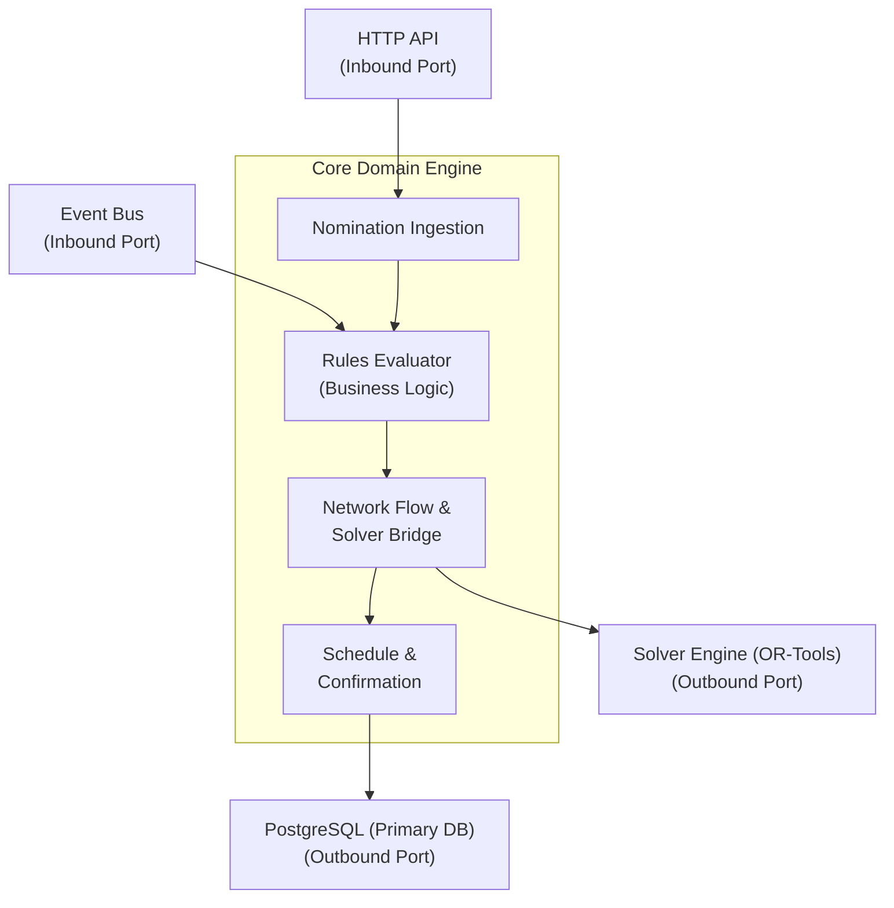
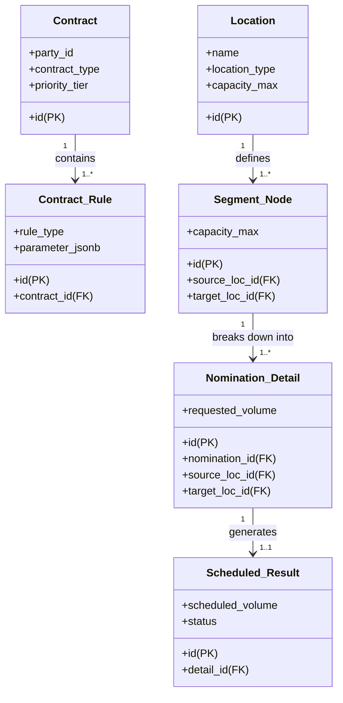

# Constrained Resource Allocation & Optimization

## Problem Classification

At its core, a pipeline scheduling engine is a **Constrained Resource Allocation and Optimization Problem**.
Specifically, it falls into three overlapping domain categories:
- *Constraint Satisfaction & Optimization Problem (CSP / COP)*: You must satisfy hard contractual rules, physical flow/pressure limits, and nomination cycles while optimizing financial yields or throughput.
- *Network Flow Optimization*: The pipeline model acts as a directed graph (trees and grids) where nodes represent injection/withdrawal locations or pools, and edges represent physical pipe capacity.
- *Dynamic Event-Driven Simulation*: Nomination cycles occur periodically throughout the day (e.g., Timely, Evening, Intraday), requiring the engine to re-evaluate state, confirm capacity, and recalculate schedules iteratively.

## Best-Fit Algorithms & Engines

Because pipeline operations combine discrete rules (priority levels, contract logic, transaction types) with continuous physical variables (gas/fluid volumes, pressure limits, capacity constraints), a single algorithm rarely suffices. A hybrid approach works best:

### Mixed-Integer Linear Programming (MILP):
- Why: Ideal for optimizing gas/oil allocations across the grid/tree while enforcing hard capacity limits, priority tiers (Primary vs. Secondary rights), and point-to-point pathing.
- Solvers: OR-Tools (Open Source by Google), CBC, or commercial solvers like Gurobi / CPLEX if scale demands it.

### Constraint Programming (CP):
- Why: Ideal for complex contract rules and business logic (e.g., "if Client A nominates at Location X on Cycle 1, apply Rule Y") before passing capacity variables into a linear solver.
- Tools: Google OR-Tools CP-SAT, Minizinc.

### Directed Acyclic Graph (DAG) Traversal & Network Flow Algorithms:
- Why: For tree-structured pipeline sub-networks, classic graph algorithms (e.g., Min-Cost Max-Flow, Ford-Fulkerson variations) calculate path availabilities faster than full MILP solvers.

## Recommended Technology Stack

To balance performance, testability, and cloud cost efficiency, a decoupled microservices or modular monolith architecture is recommended.

1. Programming Language: Rust

2. Database Layer
- Primary Transactional Data (Contracts, Nominations, Locations): PostgreSQL:
  - Fully open-source (no licensing fees), highly reliable, and supports JSONB for heterogeneous contract rules.
- Graph Data / Network Topology (Pipeline Model): PostgreSQL (using ltree or pgRouting):
  - Cost-Effective Choice: Postgres with ltree or recursive common table expressions (CTEs) models tree and grid topologies cleanly without adding extra database infrastructure costs.
- In-Memory Cache / Lock Manager: Redis (Valkey / KeyDB)
  - Used for fast lookups of active nominations during cycle processing and managing distributed engine state.

## Cloud Architecture & Cost Control (Cloud-Agnostic)
To keep cloud costs minimal while ensuring clean modularity and portability:
- *Containerization & Orchestration*: Package services into standard Docker containers managed via Kubernetes (K8s) or managed container runtimes (AWS ECS, GCP Cloud Run, Azure Container Apps).
- *IaC*: Use OpenTofu to provision standard resources (VMs, managed Postgres, object storage).
- *Cost Optimization Strategy*:
- *Serverless / On-Demand Scaling*: The scheduling engine runs heavily during specific nomination cycle windows (e.g., 4–5 times a day). Use auto-scaling worker nodes (or spot/preemptible instances for batch solving) so you only pay for high compute when a cycle is actually running.
- *Decoupled Architecture*:
```
API Gateway / Front-End 
   └─> Core API Service (PostgreSQL) 
          └─> Message Queue (RabbitMQ / NATS) 
                 └─> Scalable Engine Workers (Solvers in Rust)
```

## Key Blindspots & Major Issues

A pipeline business model has several real-world complexities that pure mathematical models often overlook:

**Nomination Cycles & Intraday Re-scheduling**: Nominations do not happen once a day; they happen in cycles:

  - Timely
  - Evening
  - Intraday_1
  - Intraday_2
  - Final

The engine must handle:

  - incremental changes
  - elapsed flow time
  - bumpability (primary firm rights bumping secondary interruptible rights mid-day)

**Physical Constraints v Commercial Logic**:
- *Line Pack & Storage*: Pipelines store inventory inside the pipe itself ("line pack"). Gas/fluid moves at real physical speeds; a point-to-point transaction isn't instantaneous.
- *Imbalance Management*: Differences between nominated amounts and physically actualized amounts create imbalances that require penalties or rolling carry-forwards.

**Complex Rules Scaling Problem**: Expressing hundreds of custom, client-specific contract rules directly as mathematical constraints can cause the solver to suffer from "combinatorial explosion" (taking hours to solve).
- Solution: Pre-calculate and validate business rules in a standard rule engine step before feeding the simplified network capacity problem to the optimization solver.

**Auditability and Determinism**: Pipeline customers will challenge allocation decisions. The scheduling engine must be strictly deterministic and maintain an exact audit trail showing why a nomination was cut or scheduled (e.g., "Cut due to Rule 4.2: Lower priority than Contract B at Segment 12").

## Architectural Design Pattern

The most suitable architecture for a pipeline scheduling engine is an Event-Driven Hexagonal Architecture (Ports & Adapters) combined with a Pipelined Processing Pattern (Rules Engine $\rightarrow$ Optimizer Engine $\rightarrow$ Output Generation).
This pattern decouples business domain logic, math solvers, and rule evaluators from cloud infrastructure, databases, and message brokers—making it fully testable, modular, and cloud-agnostic.



### Key Components & Separation of Concerns
1. Ingestion & Validation Port: Accepts nominations per cycle, validates schema completeness, and computes operational delta changes from prior cycles.
2. Rules Evaluation Engine (Pre-Solver): Validates contracts, transaction rights, priority tiers, and operational rules (e.g., minimum flow requirements, storage limits). It translates business rules into simple numerical constraints before passing data to the optimizer.
3. Solver Adapter (Abstract Interface): Converts the graph network and validated constraints into a mathematical formulation. By wrapping the solver behind an adapter interface, you can substitute Google OR-Tools, CBC, or Gurobi without touching core application code.
4. Schedule & Confirmation Service: Translates mathematical results back into business domain entities (scheduled quantities, cut reasons, capacity confirmations).

## Simplified Data Model
A relational data model designed for PostgreSQL handles complex contracts, network topologies, dynamic nominations, and execution auditability.



### SQL Schema (DDL)

```sql
-- 1. Locations (Injection, Delivery, Storage, Pools)
CREATE TABLE location (
    id UUID PRIMARY KEY DEFAULT gen_random_uuid(),
    code VARCHAR(50) UNIQUE NOT NULL,
    name VARCHAR(100) NOT NULL,
    location_type VARCHAR(20) NOT NULL CHECK (location_type IN ('INJECTION', 'DELIVERY', 'STORAGE', 'POOL')),
    max_daily_capacity_m3 NUMERIC(15, 2) NOT NULL -- Stored in cubic meters (m³)
);

-- 2. Pipeline Network Topology (Nodes & Segments for Grid/Tree Model)
CREATE TABLE pipeline_segment (
    id UUID PRIMARY KEY DEFAULT gen_random_uuid(),
    segment_code VARCHAR(50) UNIQUE NOT NULL,
    source_location_id UUID NOT NULL REFERENCES location(id),
    target_location_id UUID NOT NULL REFERENCES location(id),
    max_flow_capacity_m3 NUMERIC(15, 2) NOT NULL,
    is_active BOOLEAN DEFAULT TRUE
);

-- 3. Contracts & Flexible Business Rules
CREATE TABLE contract (
    id UUID PRIMARY KEY DEFAULT gen_random_uuid(),
    contract_number VARCHAR(50) UNIQUE NOT NULL,
    shipper_id UUID NOT NULL,
    contract_type VARCHAR(30) NOT NULL, -- e.g., 'FIRM', 'INTERRUPTIBLE', 'STORAGE'
    priority_level INT NOT NULL DEFAULT 1, -- 1 = Highest Priority (Primary Firm)
    start_date DATE NOT NULL,
    end_date DATE NOT NULL
);

CREATE TABLE contract_rule (
    id UUID PRIMARY KEY DEFAULT gen_random_uuid(),
    contract_id UUID NOT NULL REFERENCES contract(id) ON DELETE CASCADE,
    rule_type VARCHAR(50) NOT NULL, -- e.g., 'MAX_DAILY_INJECTION', 'NO_REVERSE_FLOW'
    parameters JSONB NOT NULL       -- Flexible structure for custom rule configs
);

-- 4. Nomination Headers and Line Items
CREATE TABLE nomination_cycle (
    id UUID PRIMARY KEY DEFAULT gen_random_uuid(),
    gas_day DATE NOT NULL,
    cycle_name VARCHAR(20) NOT NULL CHECK (cycle_name IN ('TIMELY', 'EVENING', 'INTRADAY_1', 'INTRADAY_2')),
    lock_time TIMESTAMPTZ NOT NULL,
    status VARCHAR(20) DEFAULT 'OPEN'
);

CREATE TABLE nomination (
    id UUID PRIMARY KEY DEFAULT gen_random_uuid(),
    contract_id UUID NOT NULL REFERENCES contract(id),
    cycle_id UUID NOT NULL REFERENCES nomination_cycle(id),
    transaction_type VARCHAR(20) NOT NULL CHECK (transaction_type IN ('POINT_TO_POINT', 'STORAGE', 'POOL')),
    created_at TIMESTAMPTZ DEFAULT clock_timestamp()
);

CREATE TABLE nomination_detail (
    id UUID PRIMARY KEY DEFAULT gen_random_uuid(),
    nomination_id UUID NOT NULL REFERENCES nomination(id) ON DELETE CASCADE,
    source_location_id UUID NOT NULL REFERENCES location(id),
    target_location_id UUID NOT NULL REFERENCES location(id),
    requested_volume_m3 NUMERIC(15, 2) NOT NULL
);

-- 5. Engine Scheduling Outputs & Audit Trail
CREATE TABLE schedule_result (
    id UUID PRIMARY KEY DEFAULT gen_random_uuid(),
    nomination_detail_id UUID NOT NULL REFERENCES nomination_detail(id),
    scheduled_volume_m3 NUMERIC(15, 2) NOT NULL,
    status VARCHAR(20) NOT NULL CHECK (status IN ('CONFIRMED', 'PARTIAL', 'CUT')),
    cut_reason_code VARCHAR(50), -- e.g., 'SEGMENT_CAPACITY_EXCEEDED', 'PRIORITY_BUMP'
    calculated_at TIMESTAMPTZ DEFAULT clock_timestamp()
);
```

## Data Pipeline Processing Execution Loop

When a scheduling run is triggered, the engine executes three sequential operations:

1. *Graph Construction*: Fetch active `location` records and `pipeline_segment` links to assemble a directed graph representation of the grid or tree network in memory.

2. *Matrix Formulation*: Map each `nomination_detail` volume request to a graph path. Formulate linear constraints where $\sum \text{Path Volumes} \le \text{Segment Capacity}$, weighted by `contract`.`priority_level`.

3. *Deterministic Persistence*: Solve the system, record `scheduled_volume_m3` in `schedule_result`, and set status codes (`CONFIRMED`, `PARTIAL`, `CUT`) with an explicit audit code explaining any reductions.
